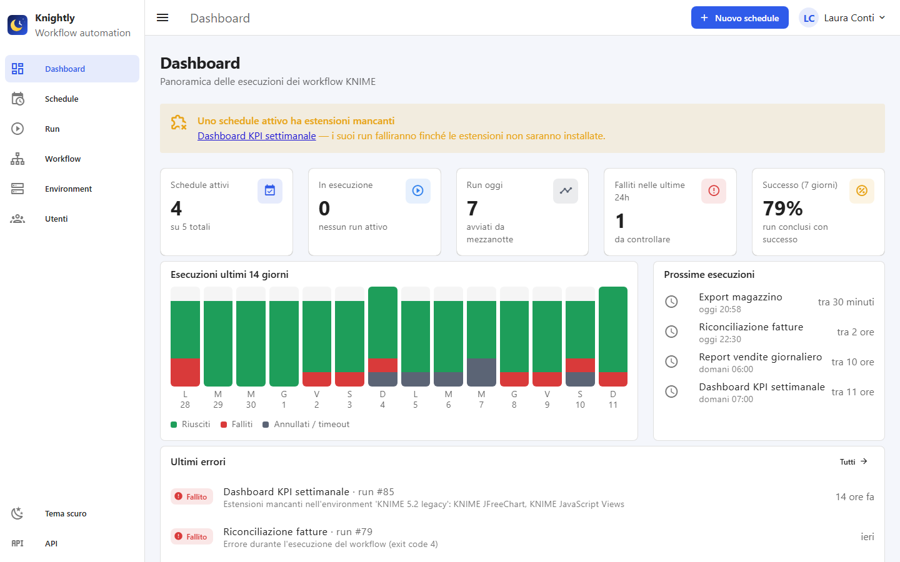
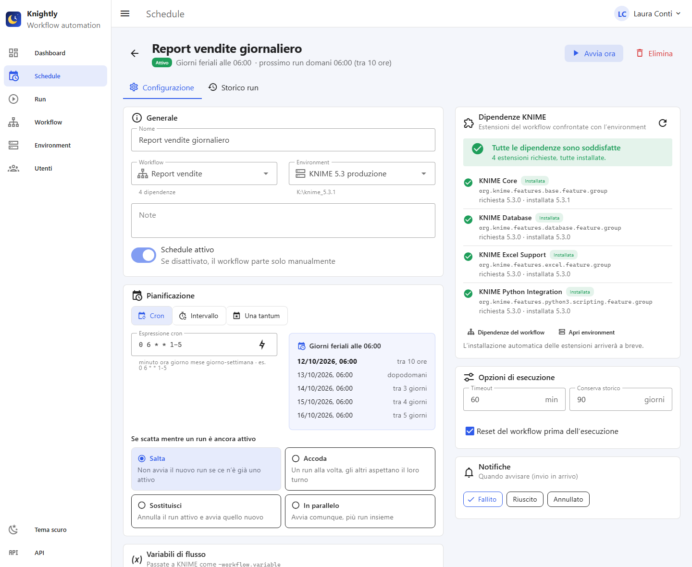
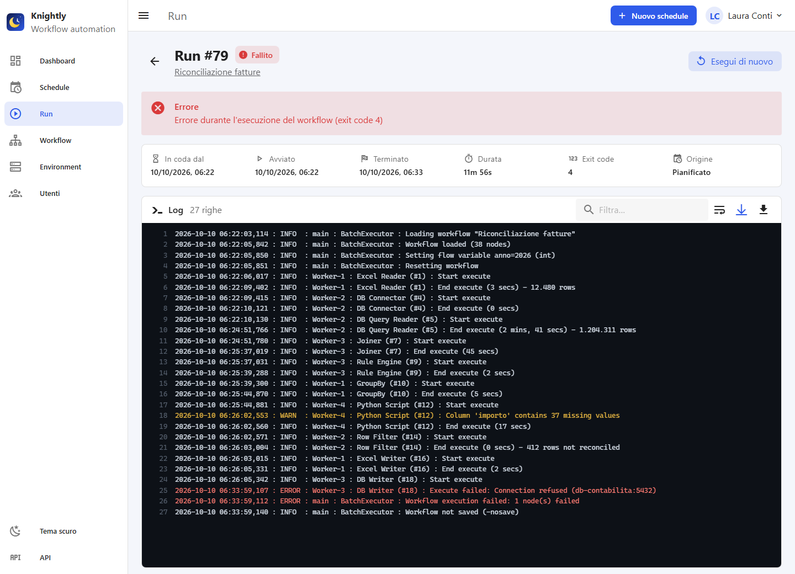
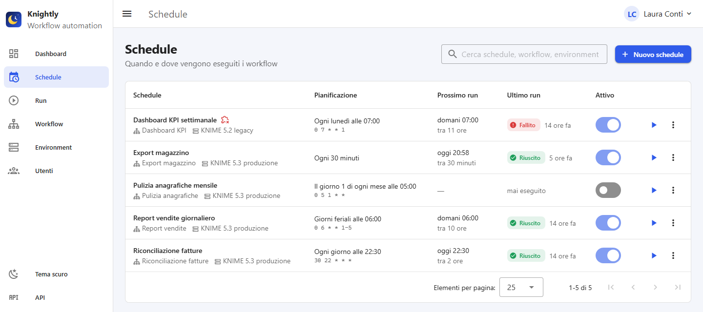
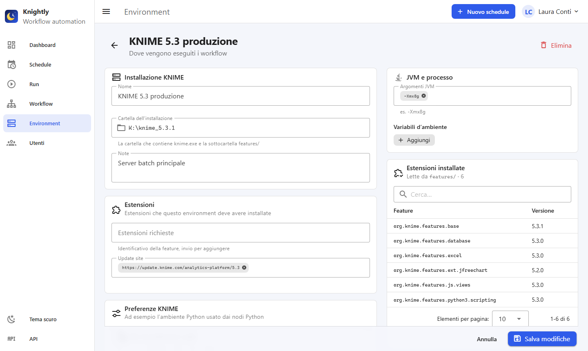
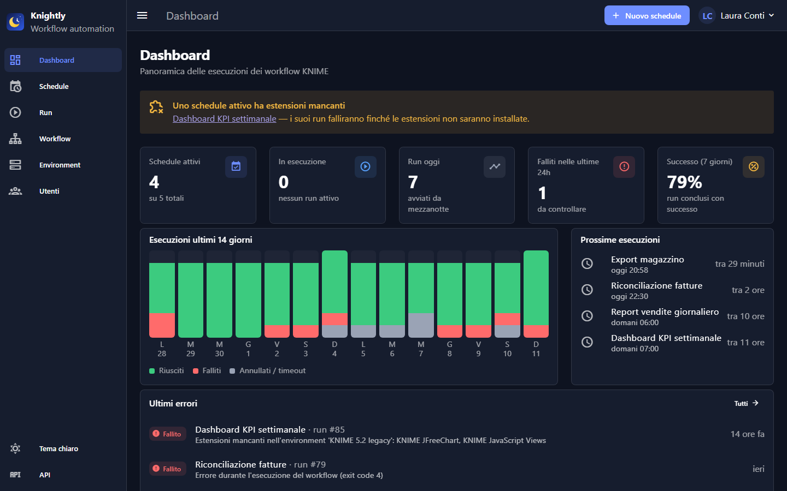
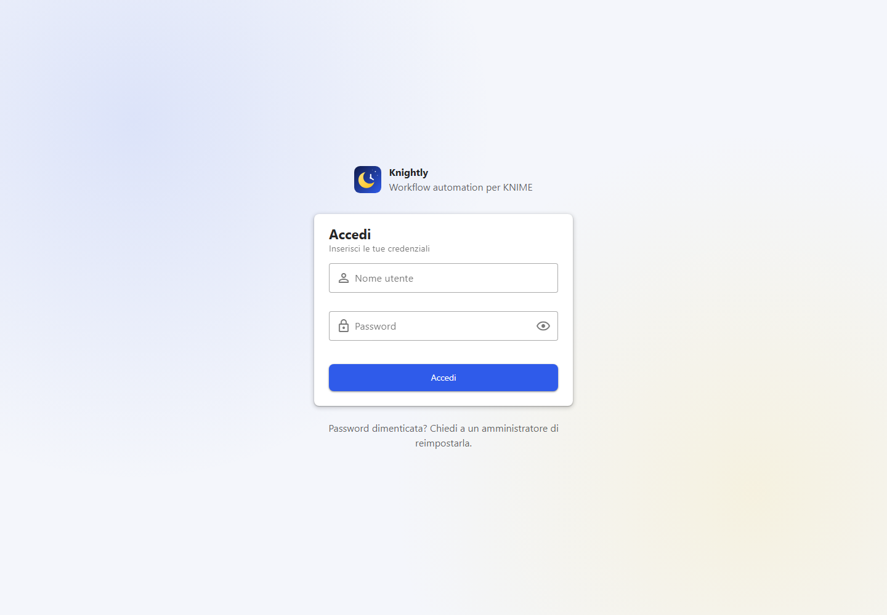

<p align="center">
  
</p>

<h1 align="center">Knightly</h1>

<p align="center">
  <b>Open-source scheduler for KNIME workflows</b><br>
  Schedule, run and monitor batch workflows on local KNIME installations,<br>
  with a web dashboard, live logs and extension dependency checks.
</p>

<p align="center">
  <a href="LICENSE"></a>
  
  
</p>

<p align="center">
  
</p>

> Knightly is an independent project: it is not affiliated with, sponsored or endorsed by KNIME AG.

## Features
- **Environments** — local KNIME installations with their extensions, preference files (`.epf`),
  extra preferences, JVM arguments and environment variables
- **Schedules** — cron expressions, fixed intervals or one-off dates, with a preview of the next runs
  and a policy for overlapping runs (skip, queue, replace, run in parallel)
- **Dependency checks** — the KNIME extensions used by each workflow are detected from the `.knwf`
  file and compared with the chosen environment; runs with missing extensions fail fast with a clear message
- **Batch execution** — workflows run through the KNIME batch executor with flow variables,
  credentials, reset, timeout and cancellation
- **Run history** — status, duration, exit code and full log, streamed live while the workflow runs
- **Web dashboard** — KPIs, 14-day chart, upcoming runs and recent failures; light and dark theme
- **Users and roles** — local accounts with viewer, operator and admin roles
- **REST API** — everything the UI does is available under `/api`, with OpenAPI docs at `/docs`

> The web interface is currently in Italian.

## Screenshots

| Schedule with dependencies and run preview | Live run log |
|---|---|
|  |  |
| **Schedules** | **Environment and installed extensions** |
|  |  |
| **Dark theme** | **Sign in** |
|  |  |

## Quick start
Requirements: Python 3.11+, Node.js (only to build the web interface) and one or more KNIME installations.

```
git clone https://github.com/silviodele/Knightly.git
cd Knightly

python -m venv .venv
.venv\Scripts\activate              # Linux/macOS: source .venv/bin/activate
pip install -e .

cd frontend
npm install
npm run build                       # builds the UI into knightly/webapp/
cd ..

python -m knightly                  # http://127.0.0.1:8000
```

On first access the web interface asks you to create the administrator account.
Then add an **environment** (the folder of a KNIME installation), upload a **workflow** (`.knwf`)
and create a **schedule**.

## Usage
```
python -m knightly                                  # start on http://127.0.0.1:8000
python -m knightly --host 0.0.0.0 --port 8080 --data-dir D:\knightly-data
python -m knightly create-user admin --role admin   # create a user (asks for the password)
python -m knightly reset-password <username>        # reset a forgotten password
```
- Data (SQLite database, uploaded workflows, run logs) is stored in `./data` or in `--data-dir`
  (also configurable with the `KNIGHTLY_DATA` and `KNIGHTLY_DB` environment variables).
- The server listens on `127.0.0.1` by default. If you expose it to other machines, put it behind HTTPS.

## Users and roles
| Role | Can |
|---|---|
| Viewer | see the dashboard, schedules, runs and logs |
| Operator | also create and edit schedules, workflows and environments, start and cancel runs |
| Admin | also manage users |

## Development
```
pip install -e ".[dev]"
pytest

cd frontend
npm run dev        # http://localhost:5173, /api calls are proxied to the backend on port 8000
```
The tests use a fake KNIME executable, so no KNIME installation is needed to run them.

### Stack
- Backend: Python · FastAPI · APScheduler · SQLAlchemy/SQLite
- Frontend: Vue 3 · Vite · TypeScript · Vuetify 4

### Project layout
- `knightly/` — application code
  - `models.py` — environments, workflows and their dependencies, schedules, runs, users
  - `dependencies.py` — reads the extensions used by a `.knwf` and compares them with an environment
  - `executor.py` — runs KNIME in batch mode
  - `scheduler.py` — triggers, run queue, concurrency policies, cancellation, history cleanup
  - `api.py`, `crud.py` — REST API and shared domain operations
  - `auth.py` — login, sessions, roles and user management
  - `webapp/` — built web interface (generated, not versioned)
- `frontend/` — Vue 3 + Vuetify web interface
- `tests/` — test suite
- `docs/` — architecture notes (Italian)

## Roadmap
- Encrypt stored credentials and avoid passing them on the command line
- Notifications (email / webhook) on failed runs
- Automatic installation of missing extensions into an environment
- English translation of the web interface

## License
[MIT](LICENSE) © 2026 Antonio Silvio de Letteriis
